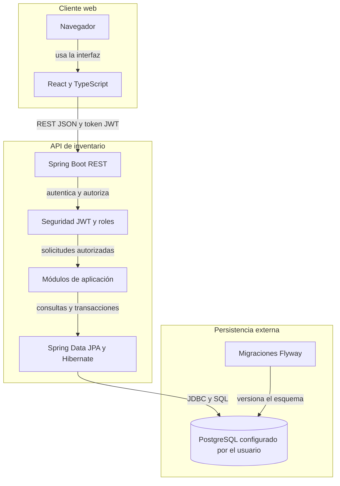
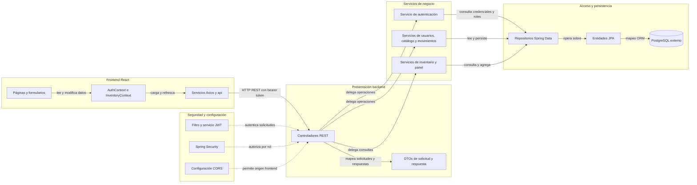

# Architecture Diagram

El proyecto separa la interfaz web, la API de inventario y la persistencia relacional. La conexión PostgreSQL se configura externamente y Flyway mantiene el esquema con migraciones versionadas al iniciar el backend.

## Application Architecture

<!-- mermaid-checked: no \n, no em-dash/en-dash, no {} in labels, subgraphs are id["label"], arrows are -->|"label"|, all subgraphs closed by end, ids unique -->

### Technology Stack Summary

| Capa | Tecnología | Versión | Propósito |
|---|---|---|---|
| Frontend | React | 19.3.1 declarado | Interfaz por páginas y componentes |
| Frontend | TypeScript | ~7.0.2 declarado | Tipado y compilación |
| Frontend | Vite | 8.3.6 declarado | Servidor de desarrollo y compilación |
| Frontend | React Router | 7.18.5 declarado | Navegación y rutas protegidas |
| Frontend | Axios | ^1.21.0 declarado | Cliente HTTP, JWT y manejo de respuestas |
| Backend | Java | 21 | Runtime de la API |
| Backend | Spring Boot | 3.4.1 | API REST, inyección de dependencias y configuración |
| Backend | Spring Data JPA / Hibernate | Administrado por Spring Boot | Persistencia ORM; validación del esquema existente |
| Backend | Spring Security | Administrado por Spring Boot | Autenticación, autorización y BCrypt |
| Backend | JJWT | 0.12.6 | Emisión y validación de tokens JWT |
| Backend | PostgreSQL JDBC | Administrado por Spring Boot | Conector disponible en ejecución; URL y credenciales externas |
| Backend | H2 | Administrado por Spring Boot | Base en memoria para pruebas |
| Backend | Springdoc OpenAPI | 2.7.0 | Documentación interactiva de la API |

### Data Storage & External Services

PostgreSQL es el almacén relacional previsto para la ejecución normal; su URL, usuario y contraseña se configuran mediante variables de entorno. Flyway aplica las migraciones versionadas y Hibernate valida el esquema resultante. H2 se utiliza únicamente en pruebas, donde Hibernate crea y elimina el esquema; no se detectaron cachés, brokers de mensajes ni integraciones de terceros en ejecución.

### Key Architectural Decisions

- Frontend React y backend REST están desacoplados y se comunican mediante JSON y JWT; la URL base del frontend es configurable.
- El backend está organizado por módulos funcionales con separación controller, service, repository, entity y DTO.
- Las escrituras usan transacciones; el stock combina bloqueo de fila para movimientos y versión optimista en producto.
- Flyway aplica el esquema versionado y Hibernate valida las entidades; el perfil de pruebas desactiva Flyway y usa H2 con `create-drop`.

## Component Relationships

<!-- mermaid-checked: no \n, no em-dash/en-dash, no {} in labels, subgraphs are id["label"], arrows are -->|"label"|, all subgraphs closed by end, ids unique -->

### Component Inventory

| Componente | Capa | Tipo | Responsabilidad |
|---|---|---|---|
| Páginas (`src/pages/`) | Frontend | React | Panel, productos, categorías, inventario, movimientos, usuarios, perfil e inicio de sesión |
| `AuthContext` | Frontend | Contexto de estado | Mantener sesión y usuario autenticado; validar sesión al iniciar |
| `InventoryContext` | Frontend | Contexto de estado | Cargar datos de API, refrescar estado y coordinar operaciones |
| Servicios Axios (`src/services/`) | Frontend | Cliente HTTP | Adaptar solicitudes por módulo, adjuntar JWT y desempaquetar respuestas |
| Controladores de módulos | Presentación backend | REST Controllers | Recibir solicitudes y delegar en servicios de dominio |
| DTOs | Contrato backend | Objetos de transferencia | Validar solicitudes y estructurar respuestas |
| `AuthServiceImpl` | Negocio backend | Servicio | Autenticar usuario y emitir JWT |
| Servicios de usuarios, categorías, productos y movimientos | Negocio backend | Servicios transaccionales | Ejecutar operaciones de dominio y coordinar repositorios |
| Servicios de inventario y panel | Negocio backend | Servicios de lectura | Construir stock, alertas y métricas desde repositorios |
| Repositorios | Persistencia backend | Spring Data JPA | Consultas derivadas y JPQL sobre entidades |
| Entidades JPA | Persistencia backend | Modelo ORM | Mapear seis tablas y relaciones |
| `JwtAuthenticationFilter` y `JwtService` | Transversal backend | Filtro y servicio de seguridad | Validar token y establecer identidad de solicitud |
| `SecurityConfig` y `CorsConfig` | Transversal backend | Configuración | Autorizar roles y permitir el origen del frontend |
| PostgreSQL externo | Persistencia | Base relacional | Guardar datos del inventario y usuarios |
