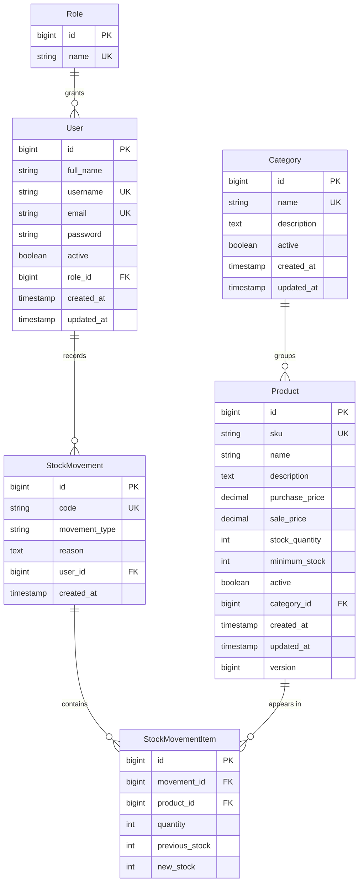

# Data Architecture & Persistence Layer

El backend modela seis entidades persistentes mediante JPA/Hibernate y está preparado para PostgreSQL. El operador configura la conexión; Flyway aplica las migraciones versionadas y Hibernate valida el esquema resultante sin modificarlo.

## Database Configuration

| Servicio/Módulo | Tipo de base | Perfil | Driver | Conexión | Herramienta de migración |
|---|---|---|---|---|---|
| Backend de ejecución | PostgreSQL | `dev` (predeterminado) | PostgreSQL JDBC, dependencia de ejecución | `DB_URL`, `DB_USERNAME` y `DB_PASSWORD`; URL local predeterminada `jdbc:postgresql://localhost:5432/inventory_db` | Flyway, migraciones `V1` a `V3` |
| Pruebas del backend | H2 en memoria, modo PostgreSQL | `test` | H2, dependencia de pruebas | Base temporal en memoria | Flyway desactivado; Hibernate `create-drop` se usa solo en pruebas |

En ejecución, Flyway aplica el esquema y crea los roles `ADMIN` e `INVENTORY_USER`; Hibernate valida las tablas y columnas sin crear ni alterar el esquema. No se cargan usuarios ni productos de prueba. El inicializador opcional de administrador crea un usuario solo cuando se configuran sus variables de entorno. No se detectaron configuraciones de caché.

## Data Ownership per Service

| Servicio | Tablas/entidades propias | ORM | Caché | Notas |
|---|---|---|---|---|
| Usuarios y roles | `users` (`User`), `roles` (`Role`) | Spring Data JPA / Hibernate | Ninguna | Administra identidad y rol persistidos |
| Categorías | `categories` (`Category`) | Spring Data JPA / Hibernate | Ninguna | Catálogo de categorías |
| Productos | `products` (`Product`) | Spring Data JPA / Hibernate | Ninguna | Mantiene existencias, precios y categoría |
| Movimientos | `stock_movements` (`StockMovement`), `stock_movement_items` (`StockMovementItem`) | Spring Data JPA / Hibernate | Ninguna | El detalle conserva cantidades y stock anterior/nuevo |
| Autenticación | Ninguna exclusiva | Spring Data JPA / Hibernate | Ninguna | Consulta usuarios y roles del módulo de usuarios |
| Inventario | Ninguna exclusiva | Spring Data JPA / Hibernate | Ninguna | Proyección de lectura basada en productos y categorías |
| Panel | Ninguna exclusiva | Spring Data JPA / Hibernate | Ninguna | Agrega lecturas de productos, categorías y movimientos |

## Entity Model

Los nombres de columna siguientes se derivan de las anotaciones JPA explícitas y de la estrategia física estándar de nombres de Hibernate. Cada ruta de origen está indicada junto a su entidad.

<!-- mermaid-checked: every attribute is `<type> <name> [<key>] ["<description>"]` with at most one of PK/FK/UK, no \n in descriptions, no {} in descriptions, every relationship label is double-quoted -->

### Entidades y estructura

| Tabla | Columnas y tipos | Restricciones/observaciones | Entidad de origen |
|---|---|---|---|
| `roles` | `id BIGINT`, `name VARCHAR(50)` | `id` es clave primaria autogenerada; `name` es obligatorio y único | `backend/src/main/java/com/inventory/modules/users/entity/Role.java` |
| `users` | `id BIGINT`, `full_name VARCHAR(150)`, `username VARCHAR(100)`, `email VARCHAR(255)`, `password VARCHAR(255)`, `active BOOLEAN`, `role_id BIGINT`, `created_at TIMESTAMP`, `updated_at TIMESTAMP` | `username` y `email` son únicos; `role_id` referencia `roles.id`; rol obligatorio. `password` almacena hash BCrypt, no texto plano | `backend/src/main/java/com/inventory/modules/users/entity/User.java` |
| `categories` | `id BIGINT`, `name VARCHAR(100)`, `description TEXT`, `active BOOLEAN`, `created_at TIMESTAMP`, `updated_at TIMESTAMP` | `name` es obligatorio y único | `backend/src/main/java/com/inventory/modules/categories/entity/Category.java` |
| `products` | `id BIGINT`, `sku VARCHAR(50)`, `name VARCHAR(200)`, `description TEXT`, `purchase_price NUMERIC(12,2)`, `sale_price NUMERIC(12,2)`, `stock_quantity INTEGER`, `minimum_stock INTEGER`, `active BOOLEAN`, `category_id BIGINT`, `created_at TIMESTAMP`, `updated_at TIMESTAMP`, `version BIGINT` | `sku` es obligatorio y único; categoría obligatoria; `version` se usa para bloqueo optimista | `backend/src/main/java/com/inventory/modules/products/entity/Product.java` |
| `stock_movements` | `id BIGINT`, `code VARCHAR(20)`, `movement_type VARCHAR(10)`, `reason TEXT`, `user_id BIGINT`, `created_at TIMESTAMP` | `code` es obligatorio y único; `movement_type` se persiste como texto (`IN`, `OUT` o `ADJUSTMENT`); usuario obligatorio | `backend/src/main/java/com/inventory/modules/movements/entity/StockMovement.java` |
| `stock_movement_items` | `id BIGINT`, `movement_id BIGINT`, `product_id BIGINT`, `quantity INTEGER`, `previous_stock INTEGER`, `new_stock INTEGER` | Referencias obligatorias a movimiento y producto; guarda el stock previo y resultante de cada línea | `backend/src/main/java/com/inventory/modules/movements/entity/StockMovementItem.java` |

Las claves `id` usan generación de identidad. Las entidades tienen marcas de tiempo de creación; usuarios, categorías y productos también tienen actualización automática. `StockMovement` mantiene una relación unidireccional de uno a muchos con sus líneas desde el lado Java, con cascada `ALL` y `orphanRemoval`. Las demás relaciones Many-to-One se mapean desde la entidad que contiene la clave foránea.

Las operaciones de escritura de usuarios, categorías, productos y movimientos usan transacciones Spring. Las consultas de lectura se marcan como solo lectura. El servicio de movimientos bloquea el producto para actualización y `Product` también tiene una columna de versión optimista.

## Key Repository Methods

| Servicio | Repositorio y entidad | Métodos personalizados relevantes | Propósito |
|---|---|---|---|
| Usuarios | `UserRepository` — `User` (`backend/src/main/java/com/inventory/modules/users/repository/UserRepository.java`) | `findByUsername`, `findByEmail`, `findByUsernameOrEmail`, `existsByUsername`, `existsByEmail`, `countActiveAdmins`, `findAllWithSearch` | Inicio de sesión, unicidad, prevención de desactivar/degradar al último administrador y búsqueda paginada |
| Roles | `RoleRepository` — `Role` (`backend/src/main/java/com/inventory/modules/users/repository/RoleRepository.java`) | `findByName` | Resolver el rol asignado a una cuenta |
| Categorías | `CategoryRepository` — `Category` (`backend/src/main/java/com/inventory/modules/categories/repository/CategoryRepository.java`) | `findByNameIgnoreCase`, `existsByNameIgnoreCase`, `findAllByActiveTrue`, `countByActiveTrue`, `findAllWithSearch` | Unicidad sin distinguir mayúsculas, selección de categorías activas, métricas y búsqueda |
| Productos | `ProductRepository` — `Product` (`backend/src/main/java/com/inventory/modules/products/repository/ProductRepository.java`) | `existsBySku`, `existsByCategoryId`, `findBySku`, `findByIdForUpdate`, `countByActiveTrue`, `countOutOfStock`, `countLowStock`, `findLowStockProducts`, `findLowOrOutOfStockProducts`, `findAllWithFilters`, `findAllWithCategory` | Unicidad, bloqueo pesimista, métricas, alertas y listados con categoría/filtros |
| Movimientos | `StockMovementRepository` — `StockMovement` (`backend/src/main/java/com/inventory/modules/movements/repository/StockMovementRepository.java`) | `findByIdWithDetails`, `findAllWithFilters`, `findRecentMovements`, `countByMovementTypeAndCreatedAtBetween` | Cargar detalles, buscar/paginar historial, movimientos recientes y agregados mensuales |
| Detalles de movimiento | `StockMovementItemRepository` — `StockMovementItem` (`backend/src/main/java/com/inventory/modules/movements/repository/StockMovementItemRepository.java`) | `findByMovementId`, `findByProductId` | Buscar líneas por movimiento o producto |

Todos los repositorios heredan CRUD estándar de `JpaRepository`. El panel no tiene repositorio propio: el servicio consulta repositorios de categorías, productos y movimientos.

## Caching Strategy

No se detectó un proveedor ni una capa de caché configurada. No hay anotaciones Spring Cache, caché de segundo nivel de Hibernate ni caché distribuida; las lecturas se ejecutan contra los repositorios y la base de datos.

## Data Ownership Boundaries

La aplicación usa una base relacional PostgreSQL compartida por los módulos, con propiedad lógica por entidad/módulo; no hay separación por servicio ni acceso a una base a través de REST interno. Servicios como el panel consultan directamente varios repositorios para componer métricas. Inventario y panel son proyecciones de lectura sobre las entidades existentes; no hay CQRS formal ni almacenamiento de lectura separado.

Flyway aplica el esquema versionado desde `src/main/resources/db/migration`; el usuario configura el datasource y debe preparar con cuidado el historial antes de apuntar a una base que ya contiene tablas. `ddl-auto: validate` hace que el inicio falle si las tablas, columnas o relaciones requeridas no coinciden. El perfil de pruebas desactiva Flyway y utiliza H2 en memoria con `create-drop`.

### Data Classification & Sensitivity

| Entidad | Campos sensibles | Clasificación | Controles presentes |
|---|---|---|---|
| `User` | `full_name`, `username`, `email` | PII | Los endpoints de administración requieren rol `ADMIN`; no hay cifrado a nivel de campo ni enmascaramiento configurado. |
| `User` | `password` | Credencial | Se almacena con hash BCrypt; no se devuelve en el DTO de usuario. |
| `Role`, `Category`, `Product`, `StockMovement`, `StockMovementItem` | No se identifican campos PII, PHI o PCI propios | Ninguna | No aplica. Los movimientos se asocian a un usuario mediante `user_id`. |

No se identificaron datos PHI ni PCI. El cifrado en reposo depende de la configuración de PostgreSQL y del almacenamiento que proporcione el operador; no está definido por el código de la aplicación.
